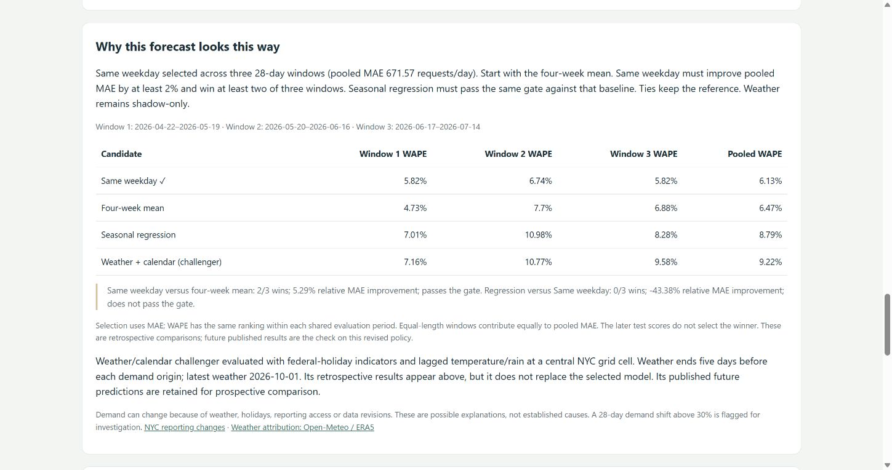

# Three-window forecast selection

Deployed October 8, 2026; dashboard compatibility and public assets verified October 9. Model version: `seasonal-demand-v4-walk-forward`. The published extract ends October 6. This dated record stays fixed while the daily dashboard advances.

## Change

A single 28-day validation month could favor a candidate because of one unusual period. Selection now compares three consecutive 28-day windows with expanding training histories. The next 42 days calibrate bands and the final 42 days evaluate the frozen choice. Each candidate uses the same forecast origins and targets.

Start with the four-week weekday mean. Same-weekday-last-week replaces it only with at least 2% lower pooled MAE and strictly lower MAE in two of three windows. Seasonal regression must pass the same gate against the resulting baseline. Ties retain the reference; weather/calendar remains shadow-only. This rule is reapplied daily rather than preserving yesterday's champion.

## Citywide comparison

| Selection window | Training observations through |
|---|---|
| April 22–May 19 | April 21 |
| May 20–June 16 | May 19 |
| June 17–July 14 | June 16 |

All dates are in 2026. Regression is refitted before each window; later evaluation blocks can use observations that have become historical.

| Candidate | Window 1 WAPE | Window 2 WAPE | Window 3 WAPE | Pooled WAPE | Later test WAPE |
|---|---:|---:|---:|---:|---:|
| Same weekday — selected | 5.82% | 6.74% | 5.82% | 6.13% | 7.10% |
| Four-week mean | 4.73% | 7.70% | 6.88% | 6.47% | 5.68% |
| Seasonal regression | 7.01% | 10.98% | 8.28% | 8.79% | 5.91% |
| Weather/calendar — shadow | 7.16% | 10.77% | 9.58% | 9.22% | 5.84% |

Same-weekday wins two windows and improves pooled MAE by 5.29% against the four-week mean. Regression wins none against same-weekday. The selection gates use unrounded MAE; WAPE provides a scale-relative display over shared targets. The later test does not choose the winner.

## Verification and limits

- 77 tests passed; Python lint and forecast JavaScript syntax checks passed. New tests cover fold boundaries, future-target exclusion, thresholds and consistency requirements.
- The deployed report contains three windows for all six series. CloudFront report, HTML and JavaScript match the release artifacts; borough switching and the comparison table were checked in Chrome.
- The daily 18:00 UTC schedule remains enabled. All three forecast alarms were OK at the October 9 verification. No new AWS services or permissions were added.
- Citywide test band coverage is 71.4%, below the nominal 90% target. Improving model selection does not repair interval calibration.
- The policy was revised after historical results had been inspected. These reused test scores are retrospective evidence, not a fresh independent test of the new policy. Prospective published forecasts and matured actuals remain necessary.
- Three windows reduce dependence on one month but do not guarantee stable choices or lower future error. Current revised source data also lacks historical publication vintages.

See the [evaluation contract](../nyc311-forecast.md), [operating policy](../model-operations.md), and [validation record](../validation.md).
