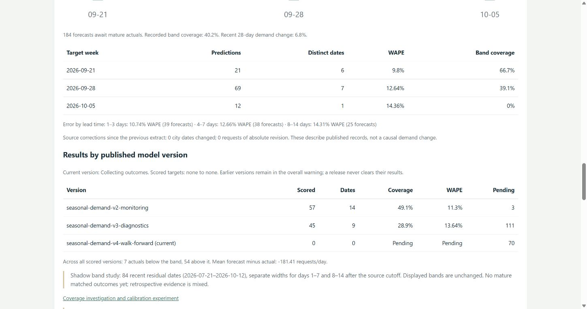

# Coverage investigation — October 14, 2026

The daily forecast published at 18:00 UTC with source data through October 12. The coverage alarm fired for Brooklyn and Manhattan; worker-error and publication alarms were OK. This was a model-quality warning, not a failed data refresh.

## Evidence

There were 102 scored forecasts per series across 14 target dates, September 22–October 5. Overlapping origins are dependent observations. Scoring waits until the source cutoff is seven days beyond a target.

| Series | Published band coverage | Actuals above band | Actuals below band | Mean forecast minus actual |
|---|---:|---:|---:|---:|
| Brooklyn | 70.6% | 25 | 5 | −192.89 requests/day |
| Manhattan | 40.2% | 54 | 7 | −181.41 requests/day |

The warning threshold is below 80% coverage after at least 28 predictions across 14 distinct target dates; nominal coverage is 90%. Most misses are underpredictions. The aggregate data does not establish a causal explanation such as weather or a reporting-policy change.

All scored predictions came from versions v2 and v3. The first retained daily issue from v4 was October 9; the October 8 release did not overwrite that day's earlier issue. There are no mature v4 outcomes at this investigation cutoff. Old errors must not be attributed to the new policy or erased after a release.

## Calibration experiment

The displayed band uses residuals from the 42-day period preceding the historical test, while production regression is refitted on all available data. Its errors therefore come from an older period and a different fitted regression. This is a plausible calibration weakness, not proof of the cause of every miss.

Candidate `rolling-84-horizon-v1` uses the latest 84 residual dates, generated out of sample in six 14-day blocks with expanding refits. It estimates separate empirical 90% error radii for source horizons 1–7 and 8–14, with 42 residuals per group. Those are horizons from the data cutoff, not the issue date. Dependent residuals, revised source data and changing demand prevent a coverage guarantee.

The experiment compares four chronological 28-day windows ending July 20, August 17, September 14 and October 12. Each window freezes selection using earlier data, then compares both band methods on identical point forecasts and targets. Refits and calibration use only data available before each simulated origin. An assumed two-day publication lag excludes nowcast horizons, leaving 24 distinct future targets per window. Historical source publication vintages are unavailable; this is exploratory retrospective evidence.

Latest window, September 15–October 12:

| Series | Reference coverage | Candidate coverage | Reference interval score | Candidate interval score |
|---|---:|---:|---:|---:|
| Bronx | 100% | 100% | 1662.75 | 1348.73 |
| Brooklyn | 79.2% | 75.0% | 1462.25 | 1366.50 |
| Manhattan | 66.7% | 75.0% | 993.96 | 1002.71 |
| Queens | 83.3% | 83.3% | 1048.96 | 1158.12 |
| Staten Island | 95.8% | 95.8% | 249.92 | 212.38 |
| NYC total | 91.7% | 87.5% | 3485.62 | 3390.48 |

The 90% interval score is width plus 20 times the distance outside the band; lower is better. It penalizes both missed outcomes and unnecessary width. Compare scores within a series, since the unit is requests. These study scores are not the published operating-history scores above.

**Decision: retain the candidate in shadow mode.** It improves some results but does not consistently reach adequate coverage; Manhattan's latest interval score worsens slightly and Brooklyn's coverage worsens. No threshold was loosened and no displayed band was silently widened.

[Complete four-window results](../interval-study-2026-10-14.json). Reproduce against the same source snapshot:

```powershell
python scripts/evaluate_intervals.py --source build/forecast/source.json
```

The study used source fingerprint `024f06658194ae83697270b4eb4b8070ffe92d28255d6dabd5063fbdc2ea8240`. A later source snapshot will produce different results.

## Operational changes

- A prominent dashboard warning identifies affected series. The table separates results and pending outcomes by published model version, with null rather than zero accuracy before outcomes mature.
- Miss direction and mean bias explain whether actuals fall above or below the displayed bands.
- Future shadow bands are saved alongside the original predictions, after successful publication. The first issue of each New York day remains immutable. A same-day release never adds a challenger to an earlier issue retroactively.
- The daily job scores shadow and displayed bands on exactly the same recorded issue/target pairs, including coverage, width and interval score. The shadow candidate cannot replace the displayed method automatically.
- Pending counts now include future targets that have not reached the source extract. Previously those predictions were retained correctly but omitted from the displayed pending count.
- Existing warning thresholds and alarms remain unchanged. No new AWS services or permissions are required.

All 81 tests, Python lint and forecast JavaScript syntax checks passed before release. A full-source comparison confirmed that point forecasts, displayed bounds, candidate metrics and saved historical issues remain unchanged.

The release published successfully on October 14 at 23:21 UTC. CloudFront HTML, JavaScript and report hashes matched the release artifacts; the saved issue history was unchanged. Chrome verification confirmed the Manhattan warning, pending v4 cohort and shadow-study disclosure. The daily 18:00 UTC schedule remained enabled; the coverage alarm remained in ALARM while error and publication alarms were OK. An October 15 check before the next scheduled run found the same current publication.



## Review rule

Review the shadow candidate after four complete target weeks have matured. Use matched issue/target pairs within each series; require at least 28 distinct target dates, candidate coverage of at least 85% in each complete week, at least 2% lower pooled interval score and lower score in at least three weeks. Mean width must not exceed 1.5 times the reference without a separate documented decision. These are review gates, not evidence that promotion is currently justified. Keep the main selection policy fixed while collecting results.

At a two-day source lag plus seven-day maturity delay, the first v4 target can be scored around October 19. If the first shadow issue is October 15, its first target can be scored around October 25. Dates depend on actual source progress. Read the version cohorts rather than assuming a calendar date means evidence is ready.

The warning remains an unresolved quality issue until new evidence supports a reviewed recovery. See the [operating policy](../model-operations.md).
